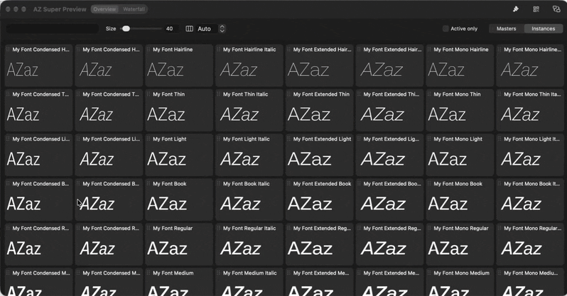
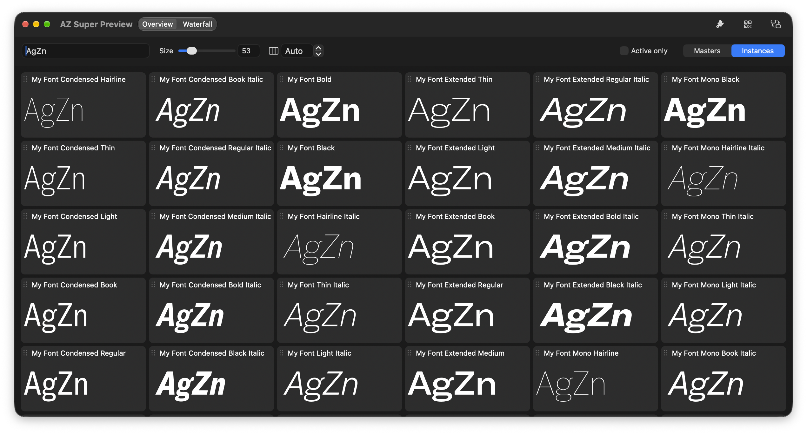
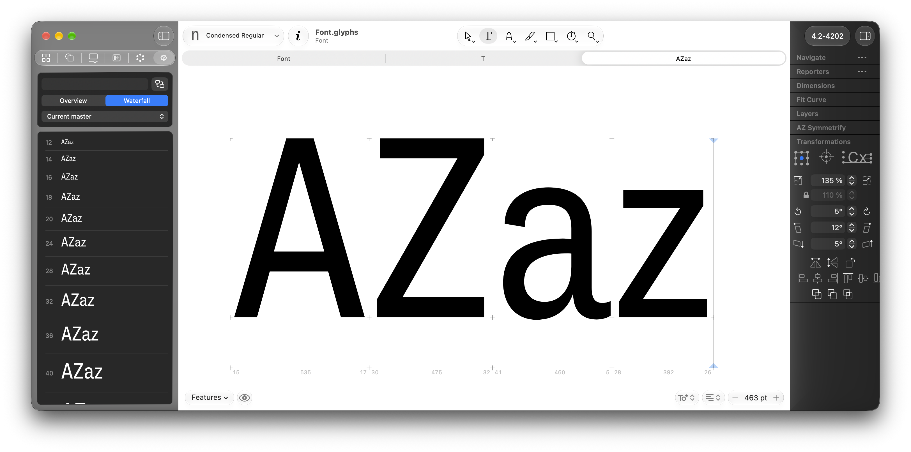
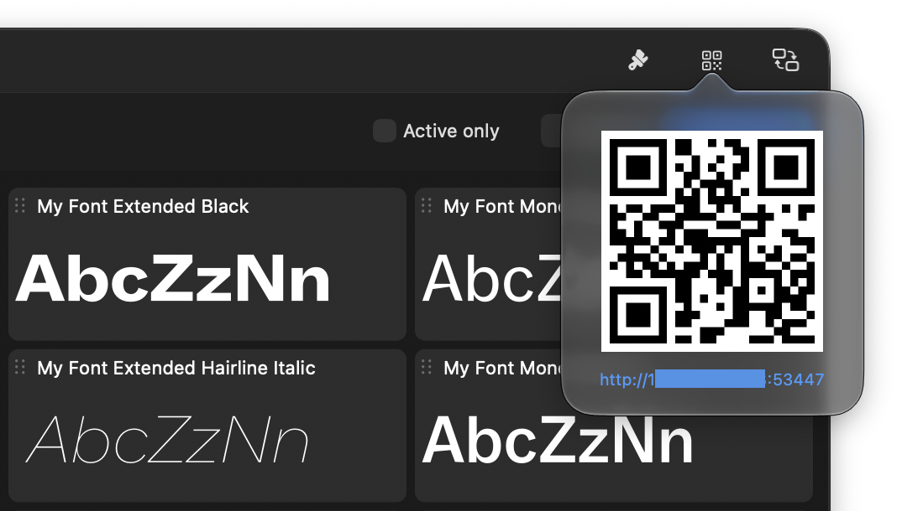

  

<h1 align="center">AZ Super Preview</h1>

  <strong>An extra window that previews all your masters and instances</strong>

  <a><picture>
    <source media="(prefers-color-scheme: dark)" srcset="https://img.shields.io/badge/Free_Plugin-6690e3">
    
  </picture></a>
  <a href="https://azerty-typefaces.com"><picture>
    <source media="(prefers-color-scheme: dark)" srcset="https://img.shields.io/badge/More_AZ_plugins-242424">
    
  </picture></a>

---

   

AZ Super Preview is a [GlyphsApp](https://glyphsapp.com/) plugin that allows to preview every master or instance, interpolated live as you draw.

 

## Getting started

1. Install AZ Super Preview with the link for your Glyphs version:
   - **Glyphs 3:** [Install in Glyphs 3](https://azerty-typefaces.github.io/AZ-SuperPreview/install.html?v=3)
   - **Glyphs 4:** [Install in Glyphs 4](https://azerty-typefaces.github.io/AZ-SuperPreview/install.html?v=4)

   Or open *Window ▸ Plugin Manager*, find **AZ Super Preview** and click *Install*.
2. Restart Glyphs.
3. Open a font with at least one master, and open a glyph in an Edit tab.
4. Open *Window ▸ AZ Toolkit ▸ Super Preview*

 

## Overview

  

One card per master or instance, all at the same size. Each card is labelled with its name and, optionally, its axis values. Cards are sorted by axis value. Variable font settings are not shown.

| Control | Does |
| --- | --- |
| **Size** | Shared point size for every card, 30 – 160. <kbd>↑</kbd> <kbd>↓</kbd> in the field step by 1, <kbd>⇧</kbd> by 10 |
| **Columns** | **Auto** fits as many columns as the window width allows; or set 1 – 10. Floating window only |

| On a card | Does |
| --- | --- |
| Click | Masters: makes that master active. Instances: sends the instance to the Edit view's Preview bar, opening it if needed |
| <kbd>⇧</kbd>-click | Pins the card as a reference. Its outline is ghosted behind every other card at the same baseline. <kbd>⇧</kbd>-click again to release |
| Drag the label | Reorders the cards. A manual order is remembered |
| Right-click ▸ **Sort priority** | Picks the axis that sorts first, and clears any manual order. Shown for fonts with two or more axes |

 

## Waterfall

  

One style down a ladder of sizes, each row labelled with its size. Set the first size with **Start** and how many sizes to show with **Steps**: each size is about 13% larger than the one before, rounded to an even size below 20 pt and to a multiple of 4 above. The default, Start 12 and 17 steps, runs 12, 14, 16, 18, 20, 24 … 48, 56, 64, 72, 80, 92. In the sidebar they're under right-click ▸ **Waterfall Sizes…**.

Tick **Multi columns** next to **Steps** to fit more sizes on one screen: sizes too low to show in a column continue at the top of the next one. You get one column plus one for every 500 pt of window width: two at the default size, three from 1000 pt wide, four from 1500 pt. Floating window only.

 

## View options

The **View** button in the toolbar opens these options. In the sidebar they live in the right-click menu. They apply only to Overview mode.

| Option | Shows |
| --- | --- |
| **Show axes value** | Axis values next to each card's name. On by default |
| **Show metrics** | Baseline, x-height, cap height, ascender and descender rules across every card. Plus **Show alignment zones** |
| **Show kerning** | Kerning gaps between glyphs, in Glyphs' own Positive / Negative Kerning colours |
| **Show spacing** | LSB · width · RSB under each glyph |
| **Show outlines** | An x-ray of the contours. Plus **Show nodes** and **Show anchors** |

 

## Preview on remote device

  

Click the **Remote** button in the floating window's toolbar and scan the QR code, or click the address under it to open the remote page in your Mac's browser. Your device must be on the same Wi-Fi network as your Mac. The remote page shows the preview with its own mode (Overview or Waterfall), sample text and a ×1 – ×4 scale, so you can browse on the device without touching the Mac.

> **Note:** The remote page is served on your local network without a password, and stays available until you quit Glyphs. Anyone on the same network who finds the address can view the preview, which is sent as a vector PDF of your outlines. Don't use it on shared or public Wi-Fi.

 

## Requirements

- **Glyphs 3 or Glyphs 4.** The sidebar tab needs Glyphs 4; everything else works in both.
- **macOS 11 Big Sur or later** (the icons are SF Symbols).

 

## Feedback

Bugs and ideas go to the [issue tracker](https://github.com/azerty-typefaces/AZ-SuperPreview/issues).

 

## Credits

Copyright © 2026 [Hugo Jourdan](https://azerty-typefaces.com). All rights reserved.

Made possible with the GlyphsSDK by Georg Seifert (@schriftgestalt) and Rainer Erich Scheichelbauer (@mekkablue).
